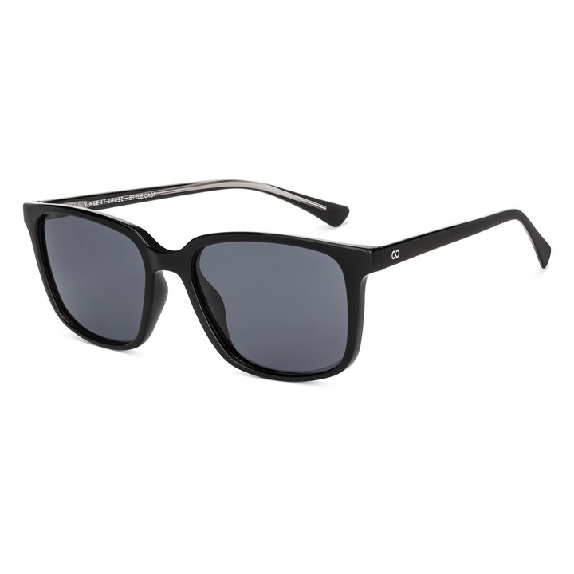
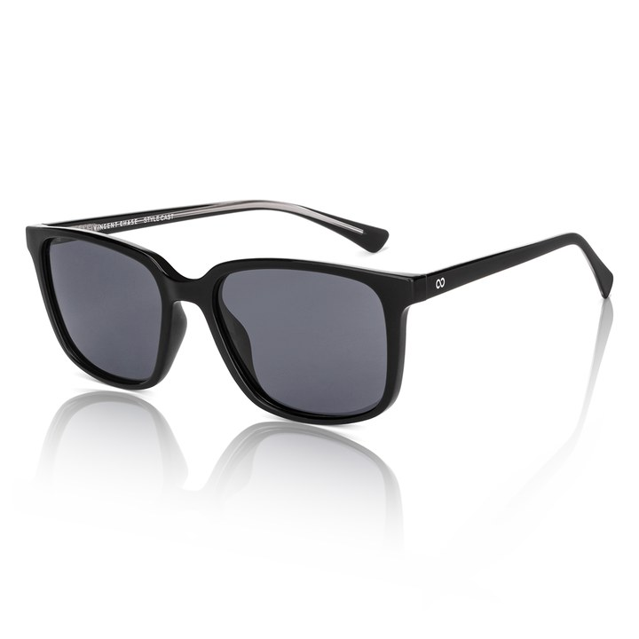

# Reflection Bench

Adds a glass-surface reflection under eyewear product photos, using geometry
only. Nothing is generated: the reflection is a warped, masked copy of the
product itself, composited underneath it. The source photo is never modified.

| Before | After |
|---|---|
|  |  |

**Why geometry instead of AI.** Reflection Bench v1 used an image-generation
model. It hallucinated: temple details came out wrong and every render was a
little different. v2 reflects the actual product pixels, so it cannot invent
anything, gives the same result every time, and runs locally for free
(about 0.14 s per image on a laptop, no GPU, no API).

---

## Quick start

```bash
pip install -r requirements.txt          # numpy, pillow, openpyxl

./run_offline.sh reflect                 # render everything in "Stock PIDs/"
./run_offline.sh fetch                   # download product plates from lenskart.com
./run_offline.sh serve                   # HTTP service on :8080
```

`run_offline.sh` with no argument prints usage. It deliberately does not
default to `all`, because a full fetch is a ~50 minute network job.

Render one image:

```bash
python3 render_reflection.py reflection-config.json -i frame.jpg -o out.png --auto
```

`--auto` detects the contact points on the image; the finish (opacity, fade,
blur) comes from the defaults in `render_reflection.py`.

### Interactive tuner

Open `reflection-bench.html` in Chrome. No server needed. Drop in an image,
click **Auto-detect contacts**, adjust the sliders, then **Export PNG** or
**Copy config**. A config copied out of the tuner renders the same in the batch
renderer and the server.

### As a service

```bash
python3 reflect_server.py --port 8080        # standard library only

curl -X POST --data-binary @frame.jpg -H 'Content-Type: image/jpeg' \
     http://localhost:8080/reflect -o out.png
curl "http://localhost:8080/reflect?opacity=0.3&blur=8" ...   # finish overrides
curl http://localhost:8080/health
```

The response carries the resolved config in an `X-Reflection-Config` header, so
every render can be reproduced. Server output is bit-identical to batch output.

---

## How it works

### 1. The core idea: two mirrors, not one

How far a reflection shifts depends on how high each point sits above the glass.
A photo has no height information, so **no single 2D warp can reflect a whole
pair of glasses**: two points at the same spot in the photo can sit at different
heights.

The frame front rests on its lens rims. The temple touches the glass only at its
tip and rises toward the hinge. Different heights need different mirrors, so the
tool runs **two independent mirrors** (front and temple) and blends them at a
split line.

### 2. The mirror is oblique

Points drop **straight down** onto the contact line. They do not reflect
perpendicular to it. In pivot-local coordinates:

```
qx = x
qy = m(1 + s)·x − s·y            m = tan(contact angle), s = depth
```

Every point on the contact line maps to itself, so the lens rims and the temple
tip each touch their own reflection without tuning.

### 3. Measured, not guessed

The constants were fitted against real reference renders, not chosen by eye:

| Part | Contact angle | Depth |
|---|---|---|
| Front | +10.0° ± 0.9 | 1.00 ± 0.02 |
| Temple | −33.2° ± 1.6 | 1.53 |

The temple fit was given no hint of where the temple tip was; its fitted contact
line came back through (970, 451), and the tip measures (970, 445).

Models that were tested and rejected, so nobody re-derives them:

| Model | Why it fails |
|---|---|
| Vertical flip about a horizontal line | Leaves gaps under the far rim in a 3/4 view |
| Perpendicular mirror about a tilted line | The fitted transforms are asymmetric; a perpendicular mirror can't be |
| Vertical squash | Measured depth is 1.00 — there is no squash |
| Single homography / harmonic homology | Can't encode per-point height (fit quality 0.01–0.25) |

### 4. Per-image pipeline

```
matte → brightness/contrast → oblique warp (front + temple) → screen-space blur
      → fade mask → composite under the untouched original
```

1. **Matte.** The background is pure white, so opacity is recovered as
   `255 − min(r, g, b)`. A small white cut removes JPEG noise.
2. **Front contact line.** An angle sweep finds the line touching the frame's
   lower edge in the most places. If that looks wrong (angle outside 8–13.5°, or
   the frame sits more than 12 px below the line) the tool falls back to the
   **bitangent**: the line both lens bottoms rest on, found on faint ink so
   rimless lens edges count.
3. **Temple tip.** The lowest ink in the outermost columns, held at the measured
   −33°.
4. **Finish.** A steep fade with heavy blur that only starts 76% of the way down
   keeps the contact edge crisp and dissolves the junction between the two
   mirrors. The front and temple fades are matched so the seam never shows as
   a step.

### 5. Quality control

`qc_v3.py` scores every render on pose, contact angle, frame size, split
position and reflection presence, and writes the raw numbers behind each
verdict. Human review remains the final gate: the thresholds were calibrated
from labelled examples, and an automated gate on its own was wrong more than
once during development.

---

## Repository layout

```
render_reflection.py    The pipeline: matte, contact detection, warp, render.
batch_reflect.py        Batch renderer (multiprocess).
reflect_server.py       HTTP wrapper, standard library only.
fetch_pids.py           Downloads product plates from lenskart.com.
run_offline.sh          Entry point: fetch | reflect | serve | all.
reflection-bench.html   Interactive tuner (standalone, offline).
reflection-config.json  Known-good baseline config.

qc_gate.py, qc_round3.py, qc_v3.py   Quality gates (v3 is current).
pose_report.py, refetch_pose.py      Find and replace wrong-pose stock photos.
build_batch1.py                      Builds a delivery batch from QC results.

research/               The fitting scripts that produced the measured constants.
CLAUDE.md               Detailed engineering notes and gotchas.
AUDIT.md                Signed audit trail of how the model was derived.
```

### Not in this repository

Product photos, rendered outputs, PID lists and tracking spreadsheets are
company data and are kept out (see `.gitignore`). The scripts expect them in
these folders when run:

| Folder | Contents |
|---|---|
| `Stock PIDs/<PID>/` | Original plates downloaded by `fetch_pids.py` |
| `Shadow Remaining PIDs.xlsx` | Source list of PIDs to process |
| `correct/` | Reference renders used by `research/` |
| `Reflection Bench Output V3/` | Rendered output |

---

## Known limitations

- The matte assumes a pure white background.
- Only the near temple is mirrored; the far temple's reflection is hidden behind
  the frame in standard 3/4 shots.
- Rimless frames, straps and brands shot at non-standard angles (e.g. Meller)
  still need human review.
- Next step under evaluation: use a monocular depth model (Depth Anything V2
  Small, runs locally in ~0.06 s/image) to separate front, temples and straps
  per pixel, instead of a straight split line.

## Requirements

Python 3.10+ with numpy, pillow and openpyxl. Use a Python that has numpy and
pillow installed, e.g. `PY=/usr/local/bin/python3 ./run_offline.sh reflect`.
